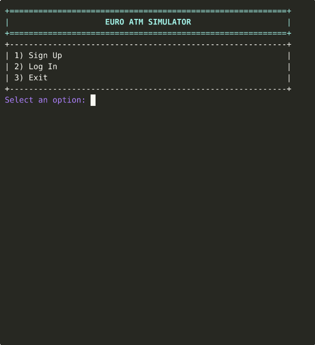

# Euro ATM Simulator

[](https://github.com/User-Paolo/atm-simulator/actions/workflows/ci.yml)

[](LICENSE)

Originally built in 2022 for university coursework.

A command line ATM simulator written in C++17. Customers can sign up, log in, deposit and withdraw cash in euro notes, and an admin panel lets you keep an eye on the machine itself.



## Features
* **Customer accounts:** Sign up and log in with a name and password.
* **Deposits and withdrawals:** Every transaction is made of real notes (5, 10, 20, 50 and 100 EUR). Each slot starts with 100 notes, and withdrawals depend on the notes the machine actually holds.
* **Note suggestions:** For any amount the ATM suggests up to three ways to make it up (fewest notes, small notes only, or no 100 EUR notes), or you can enter your own breakdown.
* **Admin panel:** Log in as `Admin` with the password `Secret` to view the total cash in the machine, the notes in each slot and the last 10 transactions, or to refill the machine.
* **Input checks:** Duplicate sign ups, wrong passwords, amounts that are not a multiple of 5, amounts over the 10,000 EUR limit per transaction, insufficient funds and empty note slots are all rejected with a clear message. The `ATM` class enforces these rules itself, so a balance can never go below zero.
* **Terminal interface:** Menus drawn with ASCII boxes and ANSI colors, with color support switched on automatically in the Windows console.

## How the Note Suggestions Work
Every amount is a multiple of 5, so the ATM counts in 5 EUR units and uses dynamic programming (a bounded coin change) to find the combination with the fewest notes. Each suggestion only uses the notes its strategy allows, and a withdrawal never uses more notes than the machine holds.

The first version used a greedy approach that always took the largest note first. That works while every slot is full, but once a slot runs low it can miss valid answers. With no 10 or 5 EUR notes left, a greedy 60 EUR withdrawal takes a 50, gets stuck on the remaining 10 and gives up, while the current version finds 3 x 20 EUR.

## Design Decisions
* **Whole euros as integers:** Money is stored as `long long` whole euros instead of `double`. An ATM only handles notes, so cents never come up, and integer arithmetic avoids floating point rounding errors entirely.
* **Logic separate from the interface:** All banking rules live in the `ATM` class and the menus in `main.cpp` only call it. This keeps the logic testable on its own.
* **Check first, then change:** Every operation validates the account, the notes and the amount before touching anything, so a rejected operation never leaves the machine half updated.
* **Typed transaction log:** Transaction types are an `enum class` rather than strings, so the compiler catches typos and missing cases.

## Project Structure
```
src/
  Account.h           Customer account data
  Transaction.h       Transaction log entry and its types
  ATM.h, ATM.cpp      Banking rules and the note suggestion logic
  UI.h                Terminal helpers (boxes, colors, input reading)
  main.cpp            Menus tying it all together
tests/                GoogleTest unit tests
docs/demo.gif         Recording of a sample session
.github/workflows/    CI for Linux, Windows and macOS
```

## Building and Running
Requires CMake 3.16 or newer and a C++17 compiler (GCC, Clang or MSVC).

```
cmake -S . -B build -DCMAKE_BUILD_TYPE=Release
cmake --build build --config Release
./build/atm_simulator
```

On Windows the program is built to `build\Release\atm_simulator.exe`. CMake downloads GoogleTest on the first build. To build without the tests, add `-DATM_BUILD_TESTS=OFF` to the first command.

## Running Tests
```
ctest --test-dir build --build-config Release --output-on-failure
```

26 unit tests cover accounts, deposits, withdrawals, the note suggestions and the admin functions, including edge cases such as very long usernames, negative note counts and amounts over the limit. Every push is built and tested on Linux, Windows and macOS through GitHub Actions, plus a Linux run with AddressSanitizer and UndefinedBehaviorSanitizer.

## Known Simplifications
* Data is kept in memory only, so everything resets when the program exits. Saving accounts to a file or SQLite database would be a natural next step.
* Passwords are stored and typed in plain text. A real system would hash them (e.g. with bcrypt) and hide them while typing.
* The admin login is fixed in the code.

## License
This project is licensed under the MIT License. See [LICENSE](LICENSE).
